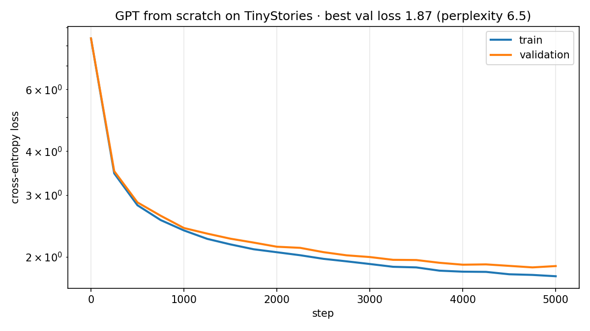

# GPT from scratch

**A GPT-style language model and BPE tokenizer written from scratch in PyTorch, trained on a MacBook in 32 minutes.**
No `transformers`, no `tokenizers` library: every piece, from byte-pair encoding to
attention to the KV cache, is implemented and tested in this repo.



## What it writes

Prompts in **bold**, everything after is generated and **unedited** except for "…" marking skipped sentences
(temperature 0.8, top-k 50, top-p 0.95, seed 7). Full outputs: [docs/samples.md](docs/samples.md).

> **Once upon a time, a little robot**. The robot was very small and very big. One day, the robot went to the park with his mom. They saw a bird with a broken wing. The robot was sad because he could not play with the bird.
> The robot said, "Don't be sad, little bird. I will help you." The bird said, "Thank you, robot. I will help you. Let's play together." They played and had fun together. …

> **Tom was sad because his dog** was not nice. He wanted to help the dog, but he did not know how. … From that day on, Tom and the dog were best friends. They played together every day. Tom was not lonely anymore.

Coherent sentences, dialogue, story arcs and endings, with typical small-model slips
(*"The robot was very small and very big"*, characters changing roles mid-story).

## Results

| | |
|---|---|
| Parameters | **12.2 M** (6 layers, 6 heads, 384-dim, context 256) |
| Tokenizer | byte-level BPE, 4,096 tokens, trained from scratch · 3.9 chars/token |
| Data | 120k TinyStories · 27.2 M training tokens |
| Training | 5,000 steps × 12,288 tokens = 61 M tokens (~2.3 epochs) |
| Hardware / time | Apple M4 Pro (MPS) · 32 min |
| Best validation loss | **1.87** (perplexity **6.5**, down from 4,372 at initialisation) |

| Step | Train loss | Val loss | Minutes |
|---|---|---|---|
| 0 | 8.38 | 8.38 | 0 |
| 250 | 3.46 | 3.51 | 1.8 |
| 1,000 | 2.38 | 2.42 | 6.7 |
| 2,500 | 1.97 | 2.06 | 16.7 |
| 5,000 | 1.76 | 1.88 | 32.3 |

## What's implemented

| File | Contents |
|---|---|
| `gpt/tokenizer.py` | Byte-level BPE: regex pre-tokenisation, merge training, encode/decode, save/load |
| `gpt/model.py` | Decoder-only Transformer: causal multi-head attention, pre-LayerNorm blocks, GELU MLP, weight tying, GPT-2 init, **KV-cached generation** with temperature / top-k / top-p |
| `prepare.py` | Streams TinyStories, trains the tokenizer, writes token files |
| `train.py` | AdamW (selective weight decay), warmup + cosine LR, gradient clipping, validation and best-checkpoint saving |
| `generate.py` / `app.py` | CLI and Gradio web demo (also shows how the tokenizer splits your prompt) |
| `tests.py` | Correctness checks (below) |

**Tested, not assumed** (`python tests.py`):
- tokenizer round-trips any text, including emoji and accents
- KV-cached generation produces the same logits as recomputing the full sequence
- hand-written attention equals PyTorch's fused `scaled_dot_product_attention`

## Run it

```bash
python -m venv .venv && source .venv/bin/activate
pip install -r requirements.txt

python prepare.py      # ~2 min: download data, train tokenizer, encode
python train.py        # ~30 min on Apple Silicon (MPS), also runs on CUDA/CPU
python generate.py "Once upon a time, a dragon"
python app.py          # web demo at http://127.0.0.1:7860
```

Skip training: download `best.pt` from the [latest release](../../releases) into `checkpoints/`.

See **[HOW_IT_WORKS.md](HOW_IT_WORKS.md)** for the theory behind each component and likely interview questions.

## References
- Vaswani et al., *Attention Is All You Need* (2017)
- Radford et al., *Language Models are Unsupervised Multitask Learners* (GPT-2, 2019)
- Sennrich et al., *Neural Machine Translation of Rare Words with Subword Units* (BPE, 2016)
- Eldan & Li, *TinyStories: How Small Can Language Models Be and Still Speak Coherent English?* (2023)

## License
MIT
